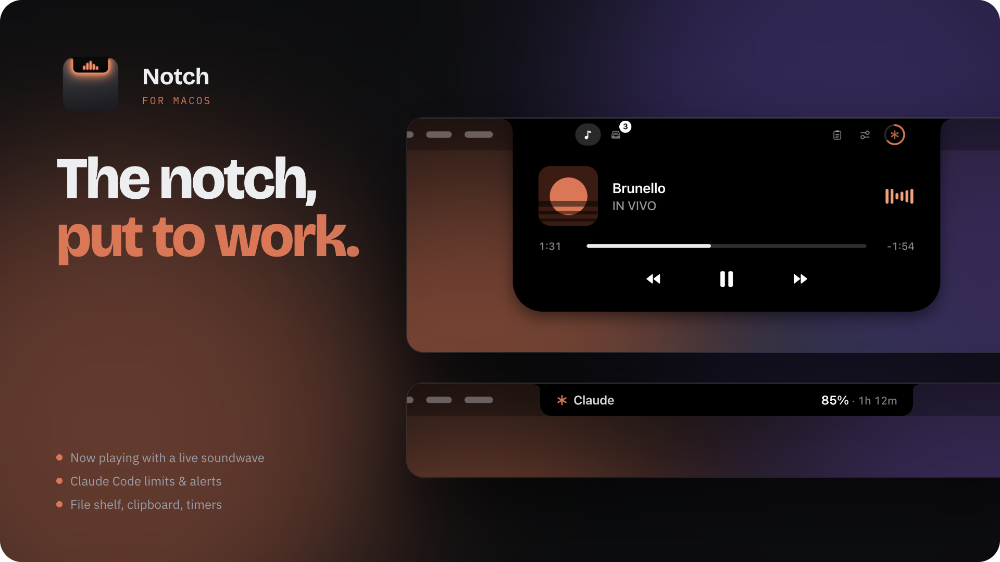
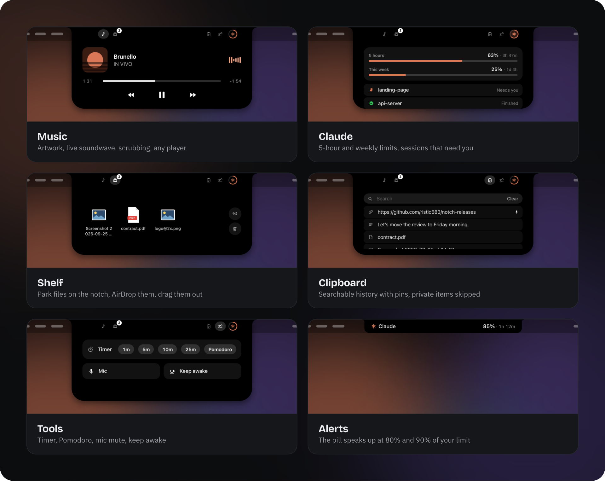
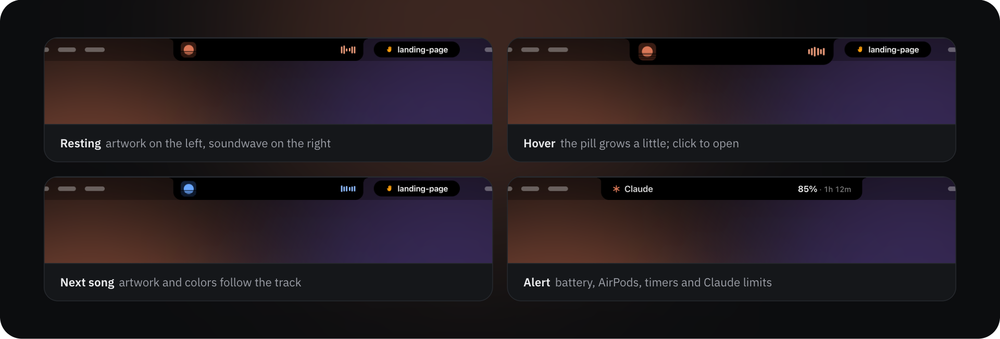

<p align="center"></p>

# Notch

[](https://github.com/ristic583/notch/actions/workflows/app.yml)


A macOS app that turns the notch into a small black pill, in the spirit of the Dynamic Island: it shows what is playing (artwork and a live soundwave), the battery, the volume and what your Claude Code sessions are doing, and it doubles as a shelf for files.

Needs macOS 14.2 or later. It works on Macs without a notch too: the pill sits centred at the top of the screen.

<p align="center"></p>
<p align="center"></p>

## What it does

- **Music.** Artwork and a soundwave beside the notch, a short preview when the track changes, and a card with controls and a scrubber. The wave can follow the real audio (asks for permission and lights the system indicator), move on its own, or stay still.
- **Volume and brightness.** Optionally (off by default) Notch takes over the volume and brightness keys and shows a slider in the pill in place of the system HUD. Needs the Accessibility permission.
- **Gestures.** A two-finger swipe on the pill skips tracks; scrolling changes the volume.
- **Battery.** An animation when the charger goes in, warnings at 20% and 10%, a note when the battery is full.
- **Clipboard.** A searchable history of what you copied (text, files, images) with pinning. Whatever password managers mark as private is skipped.
- **Shelf.** Drag files onto the notch and they stay there until you drag them on. New screenshots (and downloads, if you like) land there by themselves. Only paths are kept; nothing is copied.
- **Claude Code.** The pill tells you when a session needs your approval or has finished, with the project's name beside the notch. The Claude tab shows your subscription's five-hour and weekly usage.
- **Tools.** A timer with Pomodoro cycles, keep-awake with rules, a microphone indicator with mute, and a banner with the battery level when AirPods connect.
- **Staying out of the way.** The pill hides in full screen and, if you want, from screenshots and screen sharing.

Everything can be switched on or off in Settings (right-click the pill, or the menu bar icon).

## Install

Ready-made builds are published at [ristic583/notch-releases](https://github.com/ristic583/notch-releases/releases/latest) and update themselves. They ask for a license key. A build you make from this repository runs unlocked and does not update itself.

## Build

You need Xcode 16 or later.

```bash
scripts/build-app.sh                # universal (arm64 + x86_64), ad-hoc signed → build/Notch.app
```

```bash
ARCHS=arm64 scripts/build-app.sh    # faster, Apple Silicon only
```

```bash
open build/Notch.app
```

Keep the app in `/Applications` if you want it to launch at login.

An ad-hoc signature changes with every build, so macOS asks for the permissions again after each rebuild. To have them stick, sign with a certificate of your own: either the *Apple Development* one Xcode made when you signed in, or a self-signed one from Keychain Access (Certificate Assistant › Create a Certificate…, type *Code Signing*, then trust it for code signing).

```bash
security find-identity -v -p codesigning
```

```bash
SIGN_IDENTITY="<name of the certificate>" scripts/build-app.sh
```

For a quick run without packaging, `swift build` and start `.build/debug/Notch` with `NOTCH_BRIDGE_DIR` pointing at a folder that holds `MediaRemoteBridge.dylib` and `notch-mediaremote.pl`. Without a bundle there is no `Info.plist`, so capturing audio will not work; use the `.app` for anything beyond layout.

### Tests

```bash
swift test
```

They cover the parts that touch your files: installing the Claude Code hooks into `~/.claude/settings.json` and storing the clipboard history. They work on copies of their own and never write to the pasteboard.

## Permissions

| Permission | Why | When |
|---|---|---|
| System Audio Recording | the live soundwave | the first time something plays, if the wave is set to *Live audio* |
| Automation (Spotify, Music) | a fallback when system Now Playing gives nothing | only when it is needed |
| Screen Recording | a second way to capture audio if the first fails | not in normal use |
| Accessibility | taking over the volume and brightness keys | when you switch that option on |
| Bluetooth | the name and battery of an accessory that connects | at first launch with those banners on |
| Login Items | launching at login | when you switch it on |

While something plays, macOS shows its audio recording indicator in the menu bar. Capture runs only during playback and stops two seconds after a pause.

## What stays on your Mac

Notch has no analytics and no account of its own. It talks to the network in four cases: checking for updates (the ready-made builds, from GitHub), confirming a license (the ready-made builds), reading your Claude usage if you connect your Claude account in Settings, and fetching a cover from the address Spotify gives when the AppleScript fallback is in use.

- **Audio** is turned into six bar heights and thrown away. Nothing is recorded.
- **Clipboard history** is kept in `~/Library/Application Support/Notch/clipboard.json`, readable only by you and left out of backups. Images are kept in memory only.
- **Claude Code hooks** write the session, the kind of event and the project folder to a log the app watches. Prompts and tool output are not written anywhere.
- **Claude usage** has two sources. The status line script stores the numbers Claude Code already hands it. Connecting your account signs in the way Claude Code does, asking only for the scope that reads usage; the tokens stay in your Keychain. This uses an endpoint that is not a public API, so it can stop working.

## How it works

```
Sources/Notch
├── App/          main, AppDelegate (menu bar item, wiring)
├── Settings/     AppSettings (UserDefaults), SettingsView, UpdaterController (Sparkle)
├── Window/       NotchWindowController (mouse, gestures, file drags), NotchGeometry, FullscreenObserver
├── ViewModel/    NotchViewModel: state (collapsed / hover / expanded / preview / alert), sizes, pointer logic
├── Services/     NowPlaying, Audio, Display, MediaKeys, Agents, Clipboard, Shelf, Tools, Battery, License
└── Views/        the pill, the card and its tabs
Bridge/           MediaRemoteBridge.m, notch-mediaremote.pl, notch-agent-hook.m, notch-statusline
```

- **The window** has a fixed size and is transparent. Only the pill inside it changes size and shape, so nothing resizes and the layout never jumps. Clicks pass through the transparent part because `ignoresMouseEvents` is on except while the pointer is over the pill. The position comes from `safeAreaInsets` and the auxiliary top areas.
- **Now playing.** Since macOS 15.4 MediaRemote no longer answers third-party apps, but it still answers Apple's own binaries. So `MediaRemoteBridge.dylib` runs inside `/usr/bin/perl` (the idea behind `mediaremote-adapter`), sends JSON lines over stdout and takes commands over stdin. That covers every source, YouTube in a browser included. If the bridge gives nothing, Spotify and Music are followed through distributed notifications and AppleScript.
- **The soundwave** is a process tap on the whole system output, then a 2048-point FFT (vDSP, Hann window, hop 1024) into six logarithmic bands from 60 Hz to 14 kHz. A bar's height depends on how loud its band is against the loudest of the last seconds and on how far it rises above its own average, so the bars differ even on densely mixed music. A `CADisplayLink` draws them straight into `CALayer`s, with no SwiftUI re-render, and pauses itself in silence.
- **Volume and brightness keys** come from a `CGEvent` tap on system-defined events. A key that is handled is swallowed, so the system HUD does not appear. Brightness goes through `DisplayServices`, because the public IOKit API does not work for the built-in display on Apple Silicon.
- **Layout around the notch.** Whatever sits at camera height goes into the "wings" left and right of it. `NotchViewModel.wingWidth(for:)` says how much room a wing has, and views keep to it, so the notch can never cut through content.
- **Full screen** is checked when the Space or the frontmost app changes. Window bounds need no screen recording permission.
- **The clipboard** has no change notification, so its change counter is read every 0.7 s.
- **Claude Code hooks.** `ClaudeHookInstaller` adds and removes only its own entries in `~/.claude/settings.json`, backs the file up first and leaves a file it cannot read alone. Claude Code calls the hook; no private API is involved.
- **Bluetooth battery levels** are read from `system_profiler`, because IOBluetooth does not offer them.
- **Hiding from captures** uses `NSWindow.sharingType = .none`. Recorders that ignore it can still capture the pill.

Notch uses private macOS frameworks (MediaRemote, DisplayServices, TCC) where there is no public way. Those can change with any macOS update.

### The license check

The ready-made builds carry a license check whose sources are not in this repository. Here its place is taken by `Sources/Notch/Services/License/OpenLicense.swift`, which always says yes; `Package.swift` uses the real one when it is present.

## Contributing

Issues and pull requests are welcome. This repository is exported from the tree the releases are built from, so an accepted pull request is applied there and shows up here with the next export, not as a merge.

To report a security problem, see [SECURITY.md](SECURITY.md).

## License

Notch is source-available under the [PolyForm Noncommercial License 1.0.0](LICENSE). You can use, change and share it for any non-commercial purpose. Commercial use, such as selling it or bundling it with a product or a paid service, needs separate permission from the author. The ready-made builds are sold separately and include a license check that is not part of this repository.
